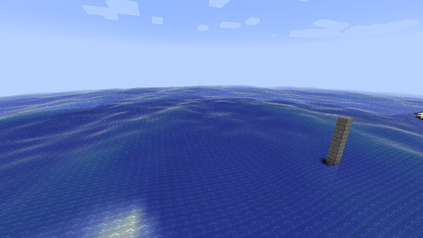
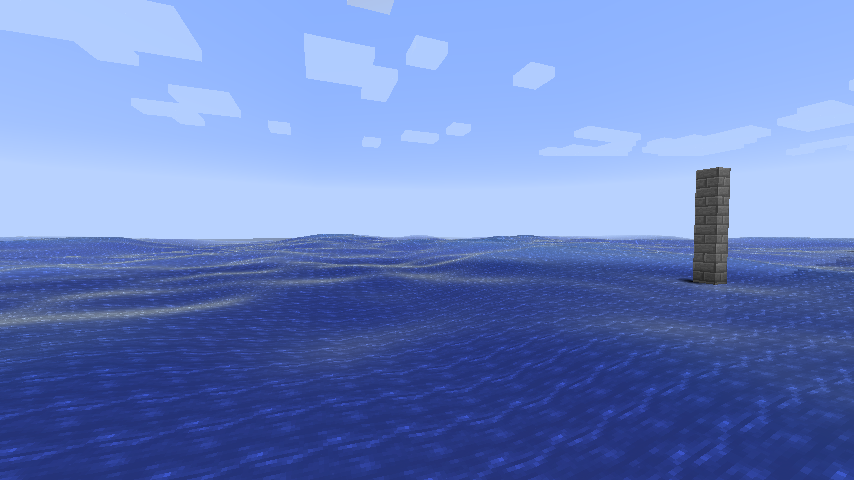
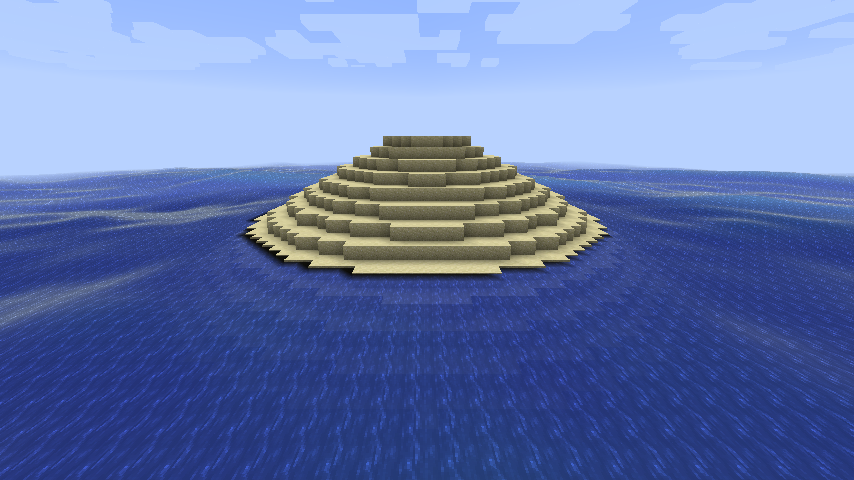
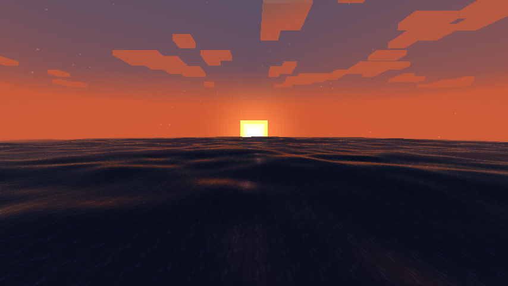
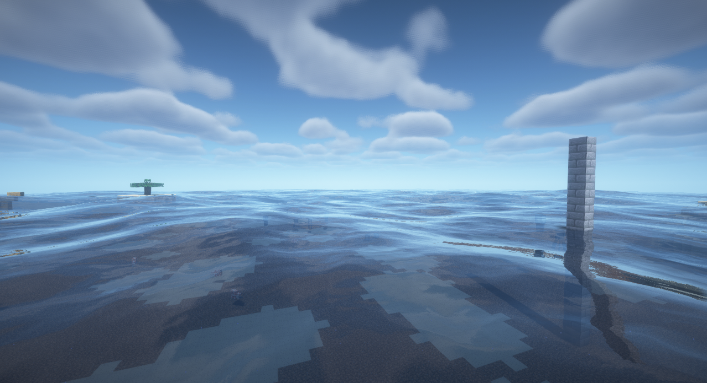
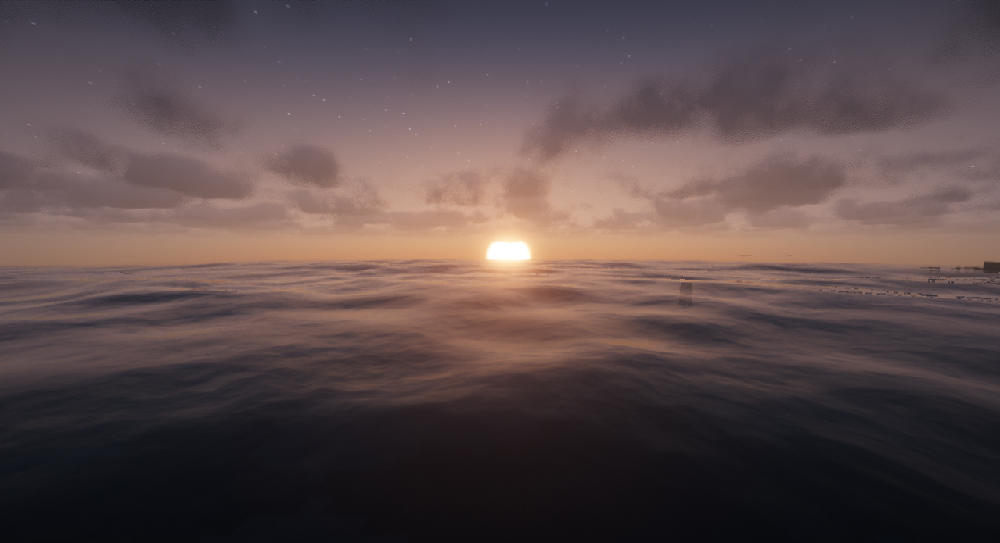

# OceanWaves

Ondas oceânicas tridimensionais para o **Minecraft 1.7.10** (Forge 10.13.4.1614), para o modpack TEOF: superfície
contínua com cristas agudas, vales largos, normais, espuma e reflexos, e **o mesmo mar no servidor e em todos os
clientes**, para a física de barcos e navios (o [Expeditions](https://github.com/Akashiic/Expeditions)). Parte da
expansão marítima junto com o [Kunftig](https://github.com/Akashiic/Kunftig) e o
[Neo States](https://github.com/Akashiic/Neo-States).

| | |
|---|---|
|  |  |
|  |  |
|  |  |

*As quatro de cima: cliente de desenvolvimento, sem shaderpack. As duas de baixo: o cliente TEOF 6.3 real com o BSL e
com o Complementary (GL por software, sem placa de vídeo).*

## O que tem

* **Mar físico**: espectro JONSWAP com espalhamento direcional de Donelan-Banner, mar de vento e marulho, fator de
  profundidade TMA, escala de Froude (o mar real em maquete). A altura significativa sai do vento e da pista.
* **Superfície trocoidal (Gerstner)** com garantia matemática de que **nunca dobra sobre si**, inclusive na costa, e
  com o nível médio da água conservado.
* **Determinístico**: o servidor manda 17 números; servidor (Java 21) e clientes (Java 8) sintetizam as mesmas
  componentes bit a bit. O tempo é o do mundo, que o vanilla já sincroniza.
* **Física**: a altura da água num ponto por Newton (convergência quadrática), retalho de alturas para cascos,
  velocidade orbital, plano de mínimos quadrados para corpos pequenos; API para mods e plugins.
* **Costa**: as ondas morrem pela distância exata à terra e pela profundidade (limite de quebra), calculadas dos
  blocos reais, iguais no servidor e no cliente.
* **Desenho**: malha por chunk com nível de detalhe espectral (sem frestas e sem estalos), a face de cima da água
  vanilla escondida só onde há ondas, luz sem shader (Fresnel, brilho do sol, pôr do sol, tom das cristas, espuma),
  e o caminho do `Tessellator` para o Angelica e os shaderpacks. Roda sem OpenGL moderno.

O que ainda não tem, e a comparação com o oceano do Physics Mod: [docs/PESQUISA.md](docs/PESQUISA.md).

## Estado

| Parte | Estado |
|---|---|
| Núcleo matemático (`core/`) | feito, 40 testes, conferido no Java 8 e no 21 |
| Mod: estado do mar no servidor, rede, `/ondas`, API | feito; **visto no servidor do Forbidden** (Crucible, 226 mods) e a API chamada de um plugin Bukkit ([relatório](docs/TESTES-AMBIENTE-REAL.md)) |
| Desenho da superfície, face vanilla escondida, costa, luz | feito; **visto no cliente TEOF 6.3** (Angelica 2.2.43 sem shader, Neo States, 218 mods) |
| Multijogador: o mesmo mar e o mesmo relógio | **visto**: cliente TEOF no Crucible, resumo das ondas igual nos dois lados, relógio assentando em 20 TPS |
| Shaderpacks (BSL, Complementary) | **integrado e visto**: o mar passa pelo programa de água do pack (reflexos, refração, sombra) ([ADR-0004](docs/adr/ADR-0004-shaderpacks.md)) |
| Mirai, modo de compatibilidade (DragonAPI sem Angelica) | **a verificar** |
| Desempenho numa placa de vídeo | **a verificar**; sem GPU, 8 chunks: ~8 a 10 ms por quadro no ambiente de desenvolvimento, ~6 a 20 ms no pack real |
| Região: ondas só em volta do spawn (padrão, raio 384) ou de um ponto, ou no mundo todo | feito; a borda da região se comporta como costa (as ondas morrem nela, sem degrau); ligada no servidor do Forbidden (raio 384 em volta do spawn, mandada ao cliente); a borda vista no jogo, **a verificar** |
| Navios do Expeditions nas ondas | feito no Expeditions (branch `claude/minecraft-ocean-physics-mod-n82b79`, `OceanWavesSea`); **visto**: o galeão flutuando no mar do OceanWaves no servidor do Forbidden ([como](docs/ARQUITETURA.md#navios-expeditions)) |
| Barcos vanilla, entidades, névoa submersa, esteiras, camada GPU | próximas fases |

## Usar

`config/oceanwaves.cfg`: o mar (`mar`, `costa`) vale pelo servidor, que o manda aos clientes; o desenho
(`desenho`) é de cada cliente. No jogo, operadores:

```
/ondas info
/ondas estado <calmo|brisa|moderado|fresco|forte|tempestade|marulho>
/ondas vento <m/s> [graus]      (0 = leste, 90 = sul)
/ondas altura <x>   /ondas escala <x>   /ondas crista <0-1>   /ondas componentes <n>
/ondas aqui                     (a água no seu ponto: altura, atenuação, inclinação, velocidade)
/ondas regiao <spawn|aqui|tudo> [raio]   (onde há ondas; padrão: 384 blocos em volta do spawn)
/ondas ligar | desligar
```

**Região.** Por padrão as ondas só existem num círculo de 384 blocos em volta do spawn do mundo (`regiao` na
configuração: `modo = spawn | ponto | tudo`, `raio`, `x`, `z`). Fora dele a água é a vanilla, parada. A borda é
tratada como costa: a atenuação das ondas cai até zero nela pelo mesmo limite de gradiente da costa, então a
superfície nunca dobra nem dá degrau. O servidor manda a região aos clientes junto com o mar; `/ondas regiao` a muda
para todos e grava na configuração.

F3 mostra o estado, o custo por quadro e o relógio. Chaves: `-Doceanwaves.disable=true` (mod inerte no cliente),
`-Doceanwaves.topFace.disable=true` (a face vanilla volta, para depurar).

## Build

```bash
./gradlew spotlessApply build -x javadoc      # núcleo + mod + testes; se o Maven Central der 429, --max-workers=1
./gradlew :core:bench                         # medidas do núcleo
```

Harness visual (cliente de desenvolvimento, mundo plano de oceano, capturas e medidas):
[docs/PLANO-DE-TESTES.md](docs/PLANO-DE-TESTES.md).

## Documentos

| Documento | Conteúdo |
|---|---|
| [docs/PESQUISA.md](docs/PESQUISA.md) | o ambiente, o oceano do Physics Mod, o estado da arte, onde igualamos e onde superamos |
| [docs/MATEMATICA.md](docs/MATEMATICA.md) | as equações, as garantias e os testes que as conferem |
| [docs/ARQUITETURA.md](docs/ARQUITETURA.md) | as camadas, o desempenho, os navios, as próximas fases |
| [docs/PLANO-DE-TESTES.md](docs/PLANO-DE-TESTES.md) | os testes, o harness e o que falta ver no jogo |
| [docs/TESTES-AMBIENTE-REAL.md](docs/TESTES-AMBIENTE-REAL.md) | o teste no servidor do Forbidden e no cliente TEOF 6.3, e os defeitos que só ali apareceram |
| [docs/adr/](docs/adr/) | as decisões de arquitetura |
