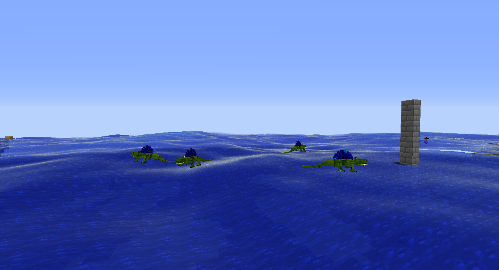
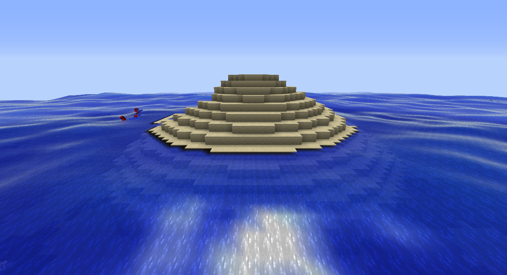
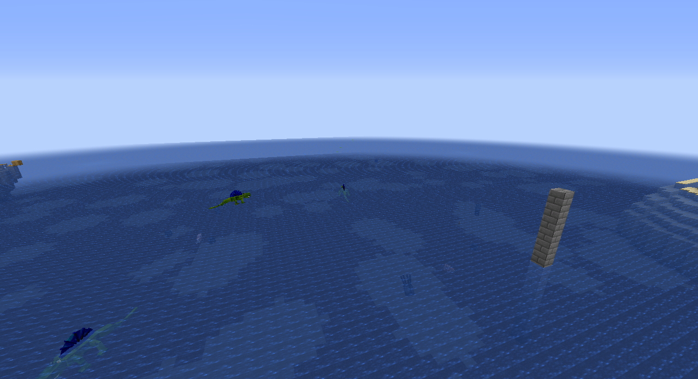
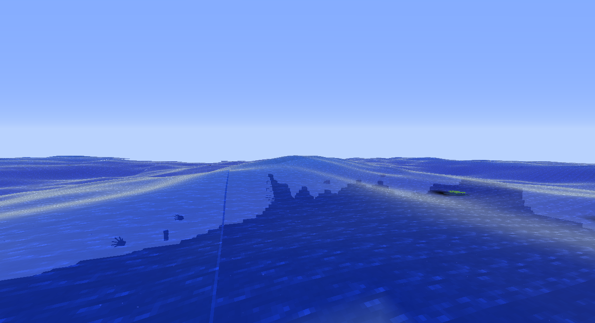
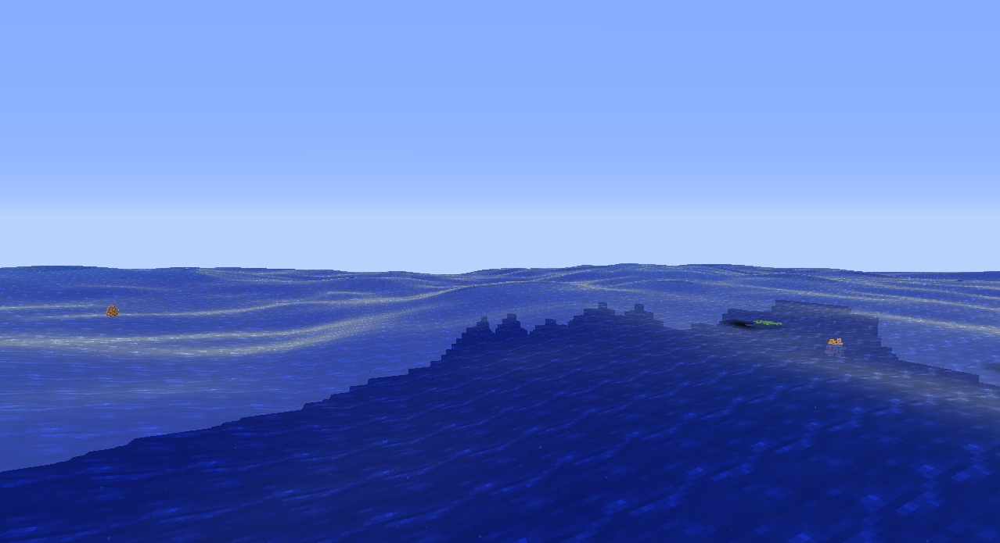
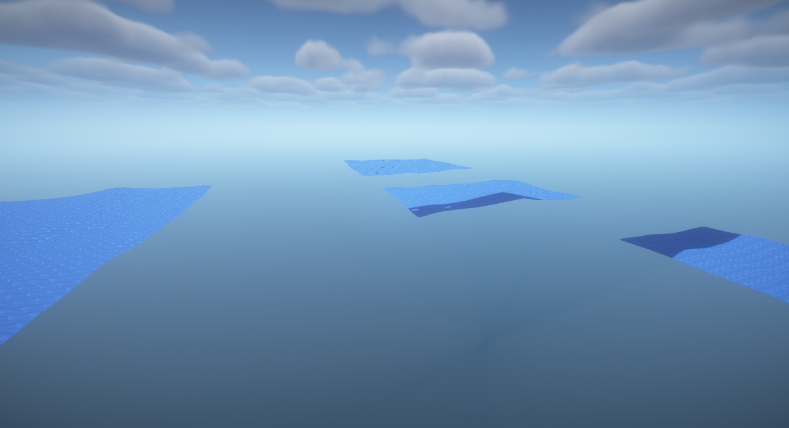
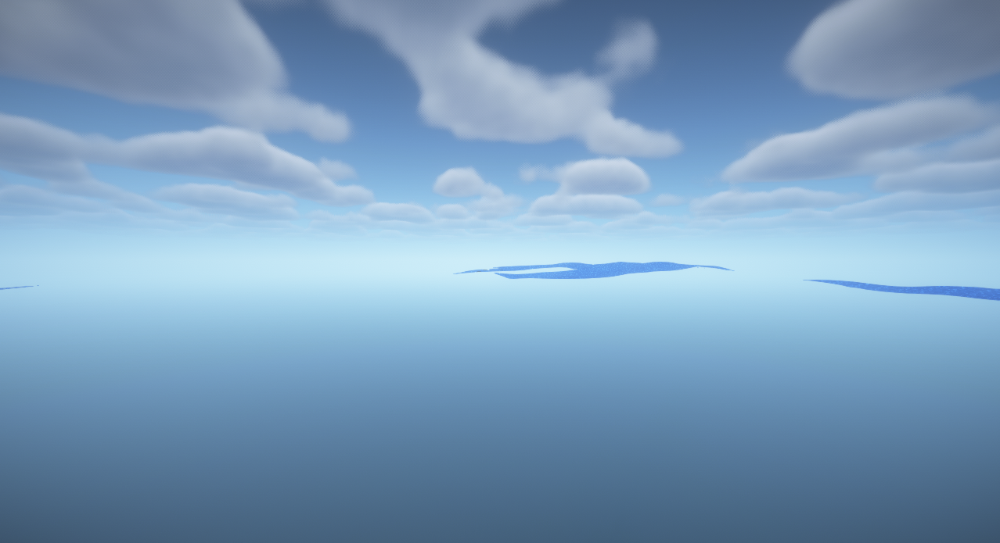

# Teste no ambiente real: servidor Forbidden e cliente TEOF 6.3

19/11/2026, neste contêiner (4 núcleos, 15 GB, **sem placa de vídeo**: Mesa llvmpipe, OpenGL 4.5 core). Arquivos:
os do servidor do Forbidden (Crucible, 226 mods, 69 plugins) e o modpack do cliente TEOF 6.3 (218 mods, Angelica
2.2.43, Neo States alpha.10, Kunftig, AkashicThePatcher beta.53, BSL e Complementary).

## Montagem

### Servidor (cópia isolada)

* `server.jar` (Crucible) com o `java9args.txt` do pacote, Java 21, `-Xmx6G`, modo **offline**, só em 127.0.0.1, mundo
  novo (o pacote não traz mundo), um operador de teste.
* **Fora**, por falarem com serviços externos ou exigirem o proxy: DiscordSRV (e a correção dele), NuVotifier,
  BungeeGuard, ProtocolObelisk, CastleOfStone, PixCraft, PixelVip, pvpstats, StatsAPI, LiteBans.
* O **LuckPerms do pacote aponta para MySQL**: na cópia, `storage-method: h2` (nada tocou no banco de produção).
* Três bibliotecas do Crucible vêm de `github.com/juanmuscaria/maven/raw/...`, que este ambiente bloqueia: baixadas de
  `raw.githubusercontent.com` (e o `server-1.7.10.jar` da Mojang), com o `.md5` ao lado que o `LibraryManager` confere.
* No `mods/`: `OceanWaves-release.jar` (sem o harness). No `plugins/`: uma **sonda** Bukkit que chama a API do
  OceanWaves como o Expeditions chamaria.

### Cliente (real, sem tela)

* O `modpack.jar` e o `minecraft.jar` do próprio pack no classpath (com as bibliotecas do Forge 10.13.4.1614 e o
  LWJGL da Mojang), Java 8u512, Xvfb + openbox, `-Xmx4G`, 1278 × 695, distância 8, o `options.txt`, as configs e os
  shaderpacks do pack. Método do `tools/headless-client` do AkashicThePatcher (beta.39).
* No `mods/`: um jar de teste do OceanWaves **com** o harness (o de lançamento o exclui).

## Resultados

### 1. Servidor: carrega, comanda e a API funciona de um plugin — verificado

* O Crucible carrega o OceanWaves junto dos 226 mods (pronto em 84 a 108 s); `[OceanWaves] Mar nas dimensões [0]`.
* `ondas info` pelo console: `Hs 1.16 m, pico de 34.6 m (período 4.7 s), …, resumo 30352b8732c2371b`. É **o mesmo
  resumo fixado** em `SynthesisTest` (que passa no Java 8 e no 21): agora conferido no servidor de verdade.
* A **sonda** (plugin Bukkit) vê a API (`API_VERSION 1`, classe carregada pelo `LaunchClassLoader`): estado, resumo
  igual, tempo do mar = tempo total do mundo / 20, a costa a partir dos blocos reais, e:

  | Medida (Java 21, servidor aquecendo) | Valor |
  |---|---|
  | `OceanWaves.surfaceY` (aloca a cada chamada; atalho) | 23 a 30 µs |
  | `OceanWaves.shore` 81 × 81 (lê os blocos) | 28 a 32 ms |
  | `HeightPatch` 48 × 16 m a 0,5 m + 300 colunas (o casco de um navio, por tick) | 1,7 ms |

  O retalho custa mais que a estimativa de 0,35 ms dos documentos (JIT ainda frio, 20 repetições): para vários
  navios, avaliar a cada 2 ticks ou com espaçamento de 1 m. A costa é para calcular uma vez e guardar.
* A sonda também acha oceano pelos biomas: no mundo `oceanwaves`, aberto em (−64, −192).

### 2. Cliente real em mundo integrado, sem shader — verificado

O harness (mundo plano de oceano, ilha, pilar) rodou os 10 casos sem erro do OceanWaves.

| | |
|---|---|
|  |  |

* **A face de cima da água some na montagem de chunks do Angelica** (Celeritas): nenhum plano chato cortando os vales.
* A costa encosta na areia sem fresta; o mar acalma no raso.
* Com o Neo States a água vanilla fica assim (mesma câmera, sem o mar do mod):
  
* Tempo de quadro (GL por software, com os 218 mods; o primeiro caso inclui o aquecimento): 64 a 80 ms com o mar contra
  58 ms com a água vanilla, ou seja, **~6 a 20 ms de custo**. A montagem de vértices no `Tessellator` do Angelica sai
  ~2,5× mais cara que no ambiente de desenvolvimento (9 a 11 ms contra 3,5): um VBO próprio é o próximo corte.
* O servidor integrado **caiu uma vez pelo JourneyMap** (`LoadedChunksToPoints.buildPolygon`, `NoSuchElementException`
  num `HashMap` iterado enquanto muda), antes de o harness começar: corrida do JourneyMap, não do OceanWaves. Para os
  testes em mundo integrado o JourneyMap ficou fora; no multijogador ele voltou e não houve queda.

### 3. Multijogador: cliente real no Crucible — verificado

O cliente entrou no servidor (FML aceitou as listas de mods) e o harness conduziu os casos por comandos no chat
(`/ondas estado …`, `/time set`, `/tp`).

* `Mar do servidor (dimensão 0)` no cliente; o **resumo no cliente (Java 8) é igual ao do servidor (Java 21)**:
  `30352b8732c2371b`.
* `/ondas estado` mudado pelo chat chega a todos na hora (resumos `cd20fb5a…` fresco, `958b5fc4…` tempestade).
* Relógio: **do servidor**; a estimativa do TPS começa em 33 a 37 (o Crucible recuperando ticks depois de gerar os
  chunks do teleporte) e assenta em **20,1**; a diferença entre o tempo do mar e o do mundo do cliente cai de 0,7 s para
  **0,02 a 0,06 s**.

| antes da correção | depois |
|---|---|
|  |  |

## Defeitos que só o ambiente real mostrou (corrigidos)

1. **Fresta na borda de chunk sobre o terreno real** (a linha escura reta da esquerda). Cada chunk calcula a atenuação
   da costa numa região com folga de 11 blocos; o limite de gradiente (envelope de cone) alcança até 14 a 23 blocos num
   mar de tempestade, então dois vizinhos davam valores diferentes na borda comum. No mundo plano não aparecia
   (profundidade uniforme). Correção: a folga vem de `ShoreField.influenceRadius` (até 32 blocos, 2 chunks; vizinhos
   avisados num raio 5 × 5); `shoreMargin` na API para quem chama `shore`. Teste novo
   `neighbouringChunksAgreeOnTheirEdge` (diverge com a folga antiga, igual com a nova). Visto corrigido no jogo.
2. **Buracos sem água com quadros lentos.** O cache relia 6 chunks por quadro; a face vanilla some em todo chunk de mar,
   então a 1 quadro/s (shaderpack em GL por software, PC fraco, logo depois de um teleporte) ficavam buracos por dezenas
   de segundos. Agora do mais perto para o mais longe, com orçamento de 3 ms por quadro.
3. Com shaderpack, por suspeita (não confirmada): o recorte por campo de visão usava o frustum vanilla, que o Iris pode
   não atualizar para a câmera, e o mar podia rodar também na passagem de sombra. Agora pula a sombra
   (`IrisApi.isRenderingShadowPass`) e não usa o frustum vanilla com shaderpack. A imagem com o BSL não mudou (abaixo).

## Shaderpack (BSL 8.2.09)

| sem a ponte | com a ponte, sem sombra e sem frustum vanilla |
|---|---|
|  |  |

**Inconclusivo, e o mar ainda não parece passar pelo programa de água do BSL**: sai claro, sem a luz e os reflexos do pack. Tentado: a ponte
`IrisBridge` (por reflexão: `GbufferPrograms.pushOverridePhase(TERRAIN_TRANSLUCENT)` e
`Iris.setShaderMaterialOverride(Blocks.water, 0)`, o caminho do Neo States); os dois ganchos existem no Angelica 2.2.43
e foram chamados (`Ponte com o Iris: fase true, material true`), sem mudança visível. Só 9 a 17 chunks aparecem como
placas claras; o resto da superfície sai na cor do céu, que pode ser a água do próprio BSL refletindo o céu (a água
vanilla com o BSL sai igual) ou falta de superfície: com 15 a 18 quadros por caso não deu para separar. **Aberto**: descobrir como o Angelica escolhe o programa para o que o
`Tessellator` desenha fora da montagem de chunks (ler o `TessellatorShaderPatch`/`ShaderManager` do Angelica), ou
desenhar o mar como malha do Celeritas. Com o BSL em GL por software o quadro leva 0,6 a 0,9 s, então este teste só
vale para a imagem.

## Para pôr no servidor de verdade

* O jar do OceanWaves vai em `mods/` do servidor **e** no modpack do cliente (o servidor sozinho funciona para a física e
  a API; o cliente sem o servidor desenha o mar da configuração dele).
* **CastleOfStone**: o SHA-256 do jar do cliente tem de entrar no `WhitelistMods.yml`, senão o jogador é recusado.
* O Expeditions já está nos plugins (`Expeditions-0.1.0.jar`): a integração com a API é o próximo passo dele.
