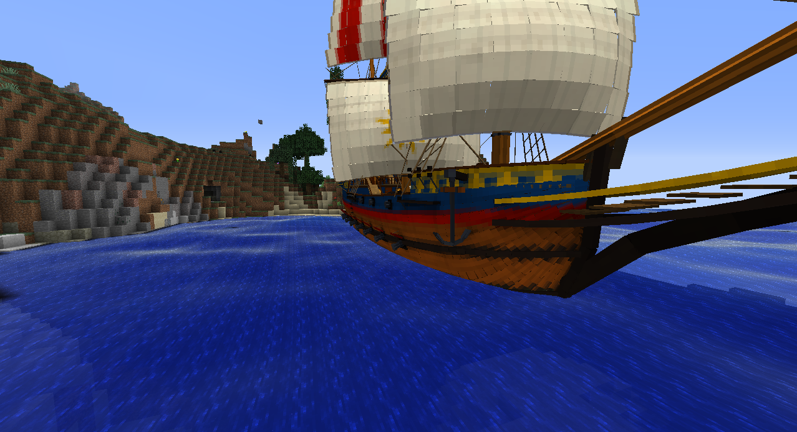
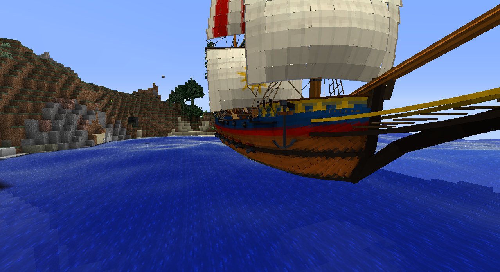
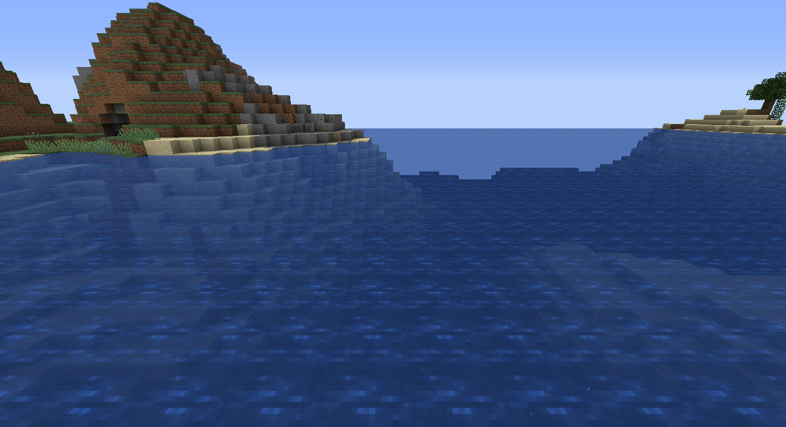
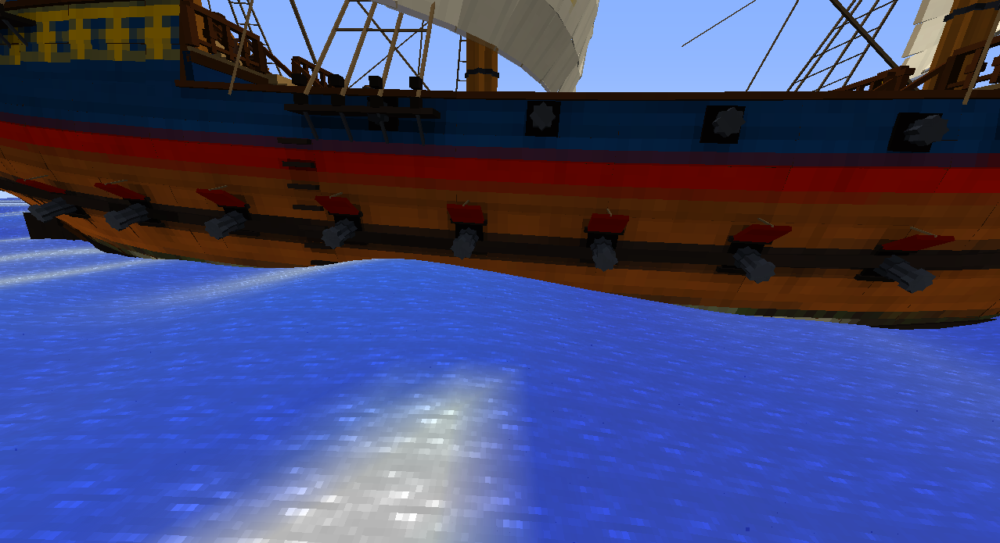
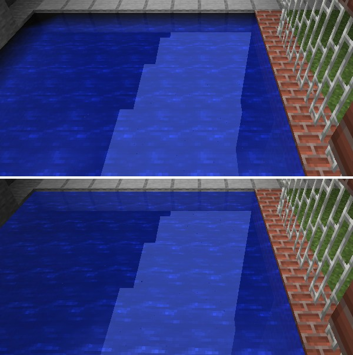
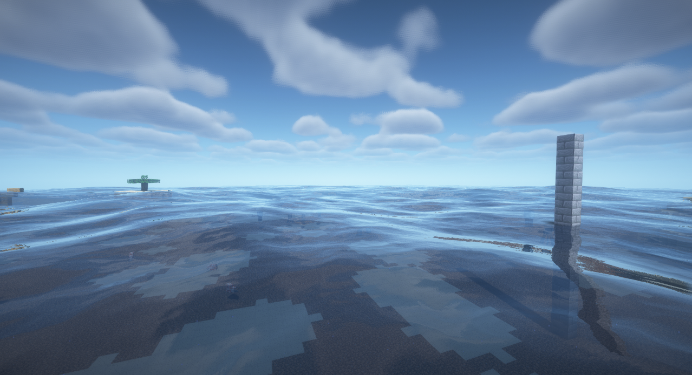
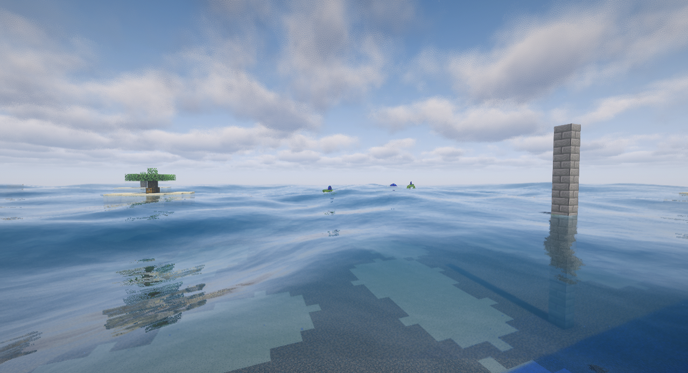
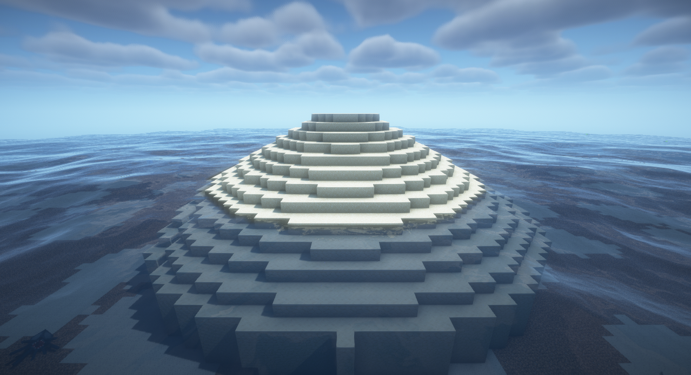
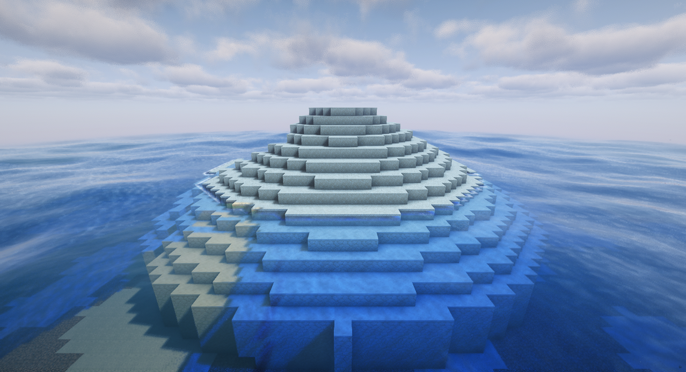

# Teste no ambiente real: servidor Forbidden e cliente TEOF 6.3

19/11/2026, neste contêiner (4 núcleos, 15 GB, **sem placa de vídeo**: Mesa llvmpipe, OpenGL 4.5 core). Arquivos:
os do servidor do Forbidden (Crucible, 226 mods, 69 plugins) e o modpack do cliente TEOF 6.3 (218 mods, Angelica
2.2.43, Neo States alpha.10, Kunftig, AkashicThePatcher beta.53, BSL e Complementary).

## Montagem

### Servidor (cópia isolada)

* `server.jar` (Crucible) com o `java9args.txt` do pacote, Java 21, `-Xmx6G`, modo **offline**, só em 127.0.0.1, mundo
  novo (o pacote não traz mundo), um operador de teste.
* **Fora**, por falarem com serviços externos ou exigirem o proxy: DiscordSRV (e a correção dele), NuVotifier,
  BungeeGuard, ProtocolObelisk, CastleOfStone, PixCraft, PixelVip, pvpstats, StatsAPI, LiteBans.
* O **LuckPerms do pacote aponta para MySQL**: na cópia, `storage-method: h2` (nada tocou no banco de produção).
* Três bibliotecas do Crucible vêm de `github.com/juanmuscaria/maven/raw/...`, que este ambiente bloqueia: baixadas de
  `raw.githubusercontent.com` (e o `server-1.7.10.jar` da Mojang), com o `.md5` ao lado que o `LibraryManager` confere.
* No `mods/`: `OceanWaves-release.jar` (sem o harness). No `plugins/`: uma **sonda** Bukkit que chama a API do
  OceanWaves como o Expeditions chamaria.

### Cliente (real, sem tela)

* O `modpack.jar` e o `minecraft.jar` do próprio pack no classpath (com as bibliotecas do Forge 10.13.4.1614 e o
  LWJGL da Mojang), Java 8u512, Xvfb + openbox, `-Xmx4G`, 1278 × 695, distância 8, o `options.txt`, as configs e os
  shaderpacks do pack. Método do `tools/headless-client` do AkashicThePatcher (beta.39).
* No `mods/`: um jar de teste do OceanWaves **com** o harness (o de lançamento o exclui).

## Resultados

### 1. Servidor: carrega, comanda e a API funciona de um plugin — verificado

* O Crucible carrega o OceanWaves junto dos 226 mods (pronto em 84 a 108 s); `[OceanWaves] Mar nas dimensões [0]`.
* `ondas info` pelo console: `Hs 1.16 m, pico de 34.6 m (período 4.7 s), …, resumo 30352b8732c2371b`. É **o mesmo
  resumo fixado** em `SynthesisTest` (que passa no Java 8 e no 21): agora conferido no servidor de verdade.
* A **sonda** (plugin Bukkit) vê a API (`API_VERSION 1`, classe carregada pelo `LaunchClassLoader`): estado, resumo
  igual, tempo do mar = tempo total do mundo / 20, a costa a partir dos blocos reais, e:

  | Medida (Java 21, servidor aquecendo) | Valor |
  |---|---|
  | `OceanWaves.surfaceY` (aloca a cada chamada; atalho) | 23 a 30 µs |
  | `OceanWaves.shore` 81 × 81 (lê os blocos) | 28 a 32 ms |
  | `HeightPatch` 48 × 16 m a 0,5 m + 300 colunas (o casco de um navio, por tick) | 1,7 ms |

  O retalho custa mais que a estimativa de 0,35 ms dos documentos (JIT ainda frio, 20 repetições): para vários
  navios, avaliar a cada 2 ticks ou com espaçamento de 1 m. A costa é para calcular uma vez e guardar.
* A sonda também acha oceano pelos biomas: no mundo `oceanwaves`, aberto em (−64, −192).

### 2. Cliente real em mundo integrado, sem shader — verificado

O harness (mundo plano de oceano, ilha, pilar) rodou os 10 casos sem erro do OceanWaves.

| | |
|---|---|
|  |  |

* **A face de cima da água some na montagem de chunks do Angelica** (Celeritas): nenhum plano chato cortando os vales.
* A costa encosta na areia sem fresta; o mar acalma no raso.
* Com o Neo States a água vanilla fica assim (mesma câmera, sem o mar do mod):
  
* Tempo de quadro (GL por software, com os 218 mods; o primeiro caso inclui o aquecimento): 64 a 80 ms com o mar contra
  58 ms com a água vanilla, ou seja, **~6 a 20 ms de custo**. A montagem de vértices no `Tessellator` do Angelica sai
  ~2,5× mais cara que no ambiente de desenvolvimento (9 a 11 ms contra 3,5): um VBO próprio é o próximo corte.
* O servidor integrado **caiu uma vez pelo JourneyMap** (`LoadedChunksToPoints.buildPolygon`, `NoSuchElementException`
  num `HashMap` iterado enquanto muda), antes de o harness começar: corrida do JourneyMap, não do OceanWaves. Para os
  testes em mundo integrado o JourneyMap ficou fora; no multijogador ele voltou e não houve queda.

### 3. Multijogador: cliente real no Crucible — verificado

O cliente entrou no servidor (FML aceitou as listas de mods) e o harness conduziu os casos por comandos no chat
(`/ondas estado …`, `/time set`, `/tp`).

* `Mar do servidor (dimensão 0)` no cliente; o **resumo no cliente (Java 8) é igual ao do servidor (Java 21)**:
  `30352b8732c2371b`.
* `/ondas estado` mudado pelo chat chega a todos na hora (resumos `cd20fb5a…` fresco, `958b5fc4…` tempestade).
* Relógio: **do servidor**; a estimativa do TPS começa em 33 a 37 (o Crucible recuperando ticks depois de gerar os
  chunks do teleporte) e assenta em **20,1**; a diferença entre o tempo do mar e o do mundo do cliente cai de 0,7 s para
  **0,02 a 0,06 s**.

| antes da correção | depois |
|---|---|
|  |  |

### 4. Ondas só no mundo do spawn, e os navios do Expeditions nelas — verificado

O spawn do servidor do TEOF é o mundo do Multiverse `Akashic/Spawn` (gerador `AkashicVoidGenerator`); a pasta dele não
veio nos arquivos do servidor, então na cópia isolada ela foi montada com as regiões do `world` (o mesmo oceano nos
dois mundos, para comparar). O Crucible guarda os mundos de plugin dentro do principal: `world/Akashic/Spawn`.

* No servidor: `Loading dimension 2 (Akashic/Spawn)` e, do OceanWaves, `Ondas no mundo Akashic/Spawn (dimensão 2): o
  mundo todo`; `/ondas info` no `world` responde `Ondas em: Akashic/Spawn (dimensão 2)` e `Sem ondas neste mundo`.
* Cliente real (harness em multijogador, `/mvtp` entre os mundos): no `world`, `Mar do servidor (dimensão 0): null`,
  0 componentes, nenhum chunk de mar desenhado, a água vanilla; no `Akashic/Spawn`, o mar do servidor com o resumo
  igual ao do servidor (`cd20fb5a…` fresco, `958b5fc4…` tempestade); de volta ao `world`, sem ondas de novo. O mar
  chega a cada troca de mundo.
* Expeditions (branch `claude/minecraft-ocean-physics-mod-n82b79`): o galeão completo posto no `Akashic/Spawn` usa o
  mar do OceanWaves (`/exp diag`: `mar do OceanWaves`), com arfagem de −1,32 a −0,01 m, caturro de −3,0° a +2,5° e
  balanço de −1,9° a +1,8° nas amostras do mar fresco; o navio sobe e desce com a mesma onda que o cliente desenha.
  Na física, o mesmo relógio do cliente (o tempo do mundo / 20).

| `Akashic/Spawn`, mar fresco | `Akashic/Spawn`, tempestade | `world`: sem ondas |
|---|---|---|
|  |  |  |

**[a verificar]** no servidor de verdade: o mundo `Akashic/Spawn` com o terreno dele (aqui foi uma cópia do `world`),
e o casamento visual do navio com a onda numa placa de vídeo (aqui, 4 a 7 quadros por segundo em GL por software).

### 5. O spawn de verdade do TEOF (Akashic/Spawn) — verificado

O mundo `Akashic/Spawn` do servidor (enviado pelo dono) é um mar feito sobre o vazio por um conversor ("void to ocean",
preset `2;31x9;0;`): 31 camadas de água de y 0 a 30, o vazio embaixo, a ilha do spawn no meio. Com o nível do mar 63 do
padrão o mod não reconhecia aquela água como mar: **não havia ondas** ("não mudou nada", no servidor de verdade).

Correção (`8b71472`): cada mundo tem o seu nível do mar, o da configuração (`Akashic/Spawn@31`, o novo padrão) ou o
medido pelo servidor em volta do spawn. Teste com o mundo de verdade e o `oceanwaves.cfg` que o pacote anterior gerou
(`Akashic/Spawn` sem o `@`, `nivel = 63`), o pior caso:

* `Ondas no mundo Akashic/Spawn (dimensão 2): o mundo todo, nível do mar 63 (o geral, até dar para medir)` ao carregar
  (os chunks do spawn ainda não estavam carregados) e, 15 s depois, `Nível do mar de Akashic/Spawn medido: 31`.
* No cliente: `/ondas info` diz `Ondas em: Akashic/Spawn (dimensão 2, nível do mar 31)`; `/ondas aqui` acha a
  superfície em Y 30,87; o mar em volta da ilha com ondas; o galeão do Expeditions posto no mar ao norte, fundeado
  (o fundo é o chão do mundo, y 0: 256 m de amarra), balançando com elas.

## Defeitos que só o ambiente real mostrou (corrigidos)

1. **Fresta na borda de chunk sobre o terreno real** (a linha escura reta da esquerda). Cada chunk calcula a atenuação
   da costa numa região com folga de 11 blocos; o limite de gradiente (envelope de cone) alcança até 14 a 23 blocos num
   mar de tempestade, então dois vizinhos davam valores diferentes na borda comum. No mundo plano não aparecia
   (profundidade uniforme). Correção: a folga vem de `ShoreField.influenceRadius` (até 32 blocos, 2 chunks; vizinhos
   avisados num raio 5 × 5); `shoreMargin` na API para quem chama `shore`. Teste novo
   `neighbouringChunksAgreeOnTheirEdge` (diverge com a folga antiga, igual com a nova). Visto corrigido no jogo.
2. **Buracos sem água com quadros lentos.** O cache relia 6 chunks por quadro; a face vanilla some em todo chunk de mar,
   então a 1 quadro/s (shaderpack em GL por software, PC fraco, logo depois de um teleporte) ficavam buracos por dezenas
   de segundos. Agora do mais perto para o mais longe, com orçamento de 3 ms por quadro.
3. Com shaderpack, por suspeita (não confirmada): o recorte por campo de visão usava o frustum vanilla, que o Iris pode
   não atualizar para a câmera, e o mar podia rodar também na passagem de sombra. Agora pula a sombra
   (`IrisApi.isRenderingShadowPass`) e não usa o frustum vanilla com shaderpack. A imagem com o BSL não mudou (abaixo).
4. **Manchas escuras na água que termina num bloco** (relatado num cais do spawn do TEOF). Cada vértice da malha lê a
   cor e a luz da coluna em cujo canto está (a de índice `(int) u`), e os vértices da borda +x e +z de uma coluna de mar
   leem a vizinha. Quando ela é terra ou bloco (a laje do cais), a cor e a luz dela nunca eram lidas: valiam 0 (preto,
   luz nenhuma), e o preto se espalhava pelo triângulo, só nos lados +x e +z da água. Correção: as colunas fechadas
   ganham a luz mais clara das colunas de mar vizinhas (céu e tochas em separado; sem vizinha no chunk, a do bloco acima)
   e a cor da água do bioma (`OceanChunks.fillClosed`). Visto corrigido no `Akashic/Spawn` real, no cais de lajes duplas
   em (101 a 106, 15) e no de tijolo em (67 a 77, −75 a −65), cliente TEOF com o Angelica (em cima antes, embaixo
   depois; a faixa escura colada às lajes e ao longo dos tijolos sumiu):

   

## Shaderpacks: BSL e Complementary — integrados

Na primeira rodada o mar saía em placas claras, sem a luz do pack. Lido o Angelica 2.2.43 (decompilado), as causas e
a correção estão na [ADR-0004](adr/ADR-0004-shaderpacks.md): o mixin desenhava depois de o Angelica fechar a fase do
passe translúcido (`setPhase(NONE)` no fim do `sortAndRender` reescrito), e o material da água de um desenho imediato
vai no atributo `mc_Entity` (`BlockMaterialAttribute`, o caminho do bloco caindo), não no override da montagem de
chunks. Com a fase `TERRAIN_TRANSLUCENT` forçada e o material da água, o pack desenha o mar com o `gbuffers_water` dele.

| BSL 8.2.09 | Complementary Unbound r5.9.3 |
|---|---|
|  |  |
|  |  |

Visto: transparência, reflexo do céu, brilho do sol, refração (o pilar e o fundo distorcidos sob a água), a cor de
profundidade do pack no raso, a sombra do pilar, e as ondas do mod por baixo de tudo. O diagnóstico do harness
confirma, no desenho: fase `TERRAIN_TRANSLUCENT`, um programa do pack ligado, 1 desenho por quadro.

O que mais apareceu e foi corrigido nessas rodadas:

* **Recorte com shaderpack**: o frustum vanilla descartava quase tudo (9 a 17 de 212 chunks); agora um cone de visão
  próprio (`ViewCone`).
* **Chunks que chegam depois**: com o Celeritas, o aviso `markBlockRangeForRenderUpdate` não chega a quem se registra
  no mundo; um chunk lido antes de chegar ficava vazio para sempre (visto: 213 no cache, 15 lidos). Agora o cache
  confere a cada quadro se ele chegou e relê alguns chunks em rodízio.
* **Sombra da água**: a face vanilla escondida tirava a água do mapa de sombra do pack. Agora o mar é desenhado também
  na passagem de sombra, com uma malha grossa própria (células de 4 blocos ou mais).
* **Borda com o Distant Horizons (Mirai)**: as ondas morrem nos últimos chunks do alcance para encontrar a água plana
  distante sem degrau (`desenho.bordaSuave`).

Uma rodada do Complementary deixou quase todo o mar sem chunks: o próprio mundo do cliente só tinha 18 chunks
carregados (o pack em GL por software e o Distant Horizons ocupando os 4 núcleos, o servidor integrado sem CPU para
mandar os chunks). Com mais tempo de carga, o cache leu os 213 a 247 chunks. É limitação deste contêiner, não do mod.

Desempenho com shaderpack aqui não diz nada (0,3 a 1 s por quadro em GL por software). Um dado vale registrar: o
envio dos vértices pelo `Tessellator` do Angelica com shaderpack custa muitas vezes mais que sem (ADR-0004,
"Custo"). **[a verificar]** numa placa de vídeo.

## Para pôr no servidor de verdade

* O jar do OceanWaves vai em `mods/` do servidor **e** no modpack do cliente (o servidor sozinho funciona para a física e
  a API; o cliente sem o servidor desenha o mar da configuração dele).
* **CastleOfStone**: o SHA-256 do jar do cliente tem de entrar no `WhitelistMods.yml`, senão o jogador é recusado.
* `mar.mundos` já vem com `Akashic/Spawn`: só ele tem ondas. Para outro mundo, o nome da pasta dele (o do Multiverse)
  ou o número da dimensão.
* O Expeditions do branch `claude/minecraft-ocean-physics-mod-n82b79` usa este mar (precisa da API 2, este jar ou
  mais novo); o `Expeditions-0.1.0.jar` que está hoje no servidor é anterior e continua com o mar plano dele.
